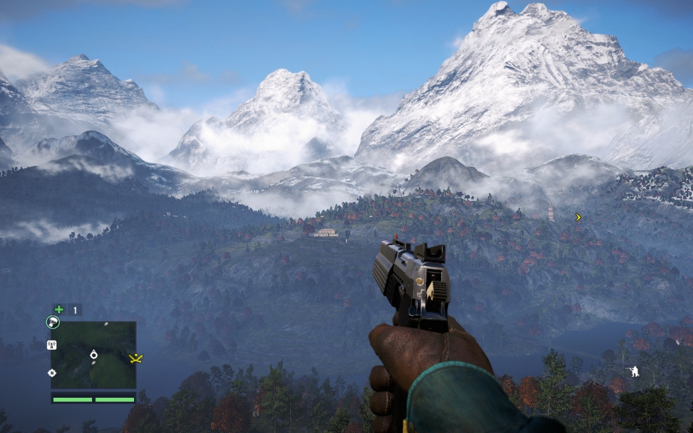
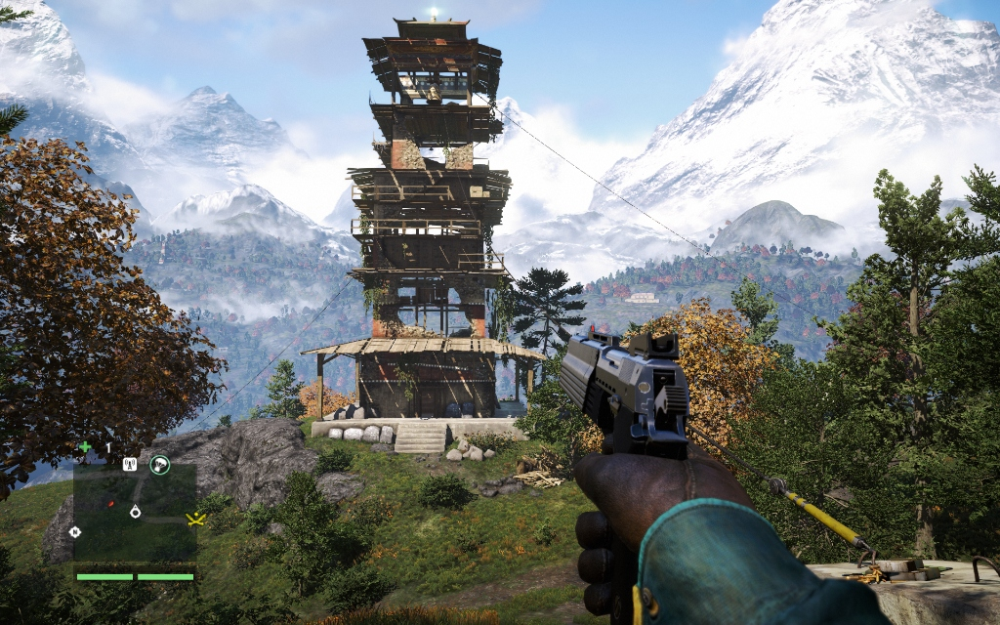

# Far Cry 4 Screen Patch

Universal aspect ratio, black-bar removal, FOV scaling, and adaptive UI/HUD patch for the 64-bit PC (Steam / Ubisoft Connect) version of **Far Cry 4**.

Designed to adapt the game viewport and all internal Scaleform/Flash UI elements to any aspect ratio without stretching, distorting, or cropping the image.

## Key Features

- **Zero `.text` Code Modification**: Operates exclusively through read-only AOB symbol discovery (17/17 engine symbols) and runtime updates to engine `.data` structures, heap-allocated VTables, and FireUI display nodes. This preserves `FC64.dll` code integrity and avoids background integrity shutdowns.
- **Complete Black Bar Removal (Gameplay, Menus, Map, Shops & Loading)**: Normalizes `DisplayViewportInfo` structures to `{0, 0, W-1, H-1}`, disables the `2.2:1` ultrawide 3-monitor split, suppresses FireUI's `BlackBarsMC` / `staticBlackBars` and baked `1280x200` / `6000x500` off-stage bars (uncovering the full World Map, Pause Menu, Shop, Skills/Crafting, Weapon Wheel, and Loading Screens), and applies aspect-preserving `Cover-Fit` to full-screen backdrops (including Main Menu, `Press Any Key`, and Loading Screens).
- **Pre-Recorded Video Aspect Fix & Any-Key Skip (`F8` Toggle)**: Expands pre-recorded Bink videos (startup intros and story cutscenes) edge-to-edge using aspect-preserving `Cover-Fit` without stretching, and provides an independent option to skip non-looping pre-recorded videos with any key, mouse click, or gamepad button (toggleable in-game anytime with `F8` via a discrete native prompt).
- **Universal Aspect Ratio Support**: Tested across `4:3`, `5:4`, `4:5`, `3:2` (`1.50:1`), `16:10`, `16:9`, `1.85:1`, `2:1`, `18:9`, `19.5:9`, `20:9`, `21:9` (`2.375:1`), `2.35:1` / `2.39:1` / `2.40:1`, `2.76:1`, `9:16`, and `19.5:1`.
- **Adaptive 9-Point UI and HUD Layout**: Dynamically updates active FireUI `UiAnchorObj` elements across loaded movies using uniform proportional scaling (`min(W / 1280, H / 720)`) for HUD/menus and `Cover-Fit` for full-screen backdrops.
- **Full-Viewport Menu Cursor:** Expands the legacy 16:9 mouse confinement to the focused game window when the viewport is expanded.
- **Correct Native FOV Scaling**: Automatically sets `UseWidescreenFOV` to **Vert+** (`0`) at `<= 16:9` (preventing horizontal cropping) and **Hor+** (`1`) at `> 16:9` (preserving vertical FOV).
- **Resolution Filter Removal**: Hooks `ModeProvider` via its heap VTable to remove aspect-ratio filtering in the video options menu.

## Screenshots

Captured in-game running on a 16:10 display with full edge-to-edge viewport rendering, no pillarbox or letterbox bars, unstretched Scaleform HUD anchoring, and corrected Vert+ vertical FOV:

### Full-Screen Panoramic Vista and Adaptive HUD Anchoring


### Vertical Architecture and Proportional Viewmodel / Minimap Scaling


### Uncropped Vertical Field of View (Vert+)


## Installation (Pre-built Release)

1. Download the latest release archive from the [Releases page](https://github.com/XssentialPilar/FarCry-4-Screen-Patch/releases/latest).
2. Extract `dinput8.dll` and `FC4_AspectFix.ini` directly into your Far Cry 4 `bin` folder (next to `FarCry4.exe` and `FC64.dll`), for example:
   ```text
   C:\Program Files (x86)\Steam\steamapps\common\Far Cry 4\bin\
   ```
3. Launch the game normally from Steam or Ubisoft Connect.
4. *(Optional)* While watching any intro video or cutscene, press `F8` at any time to toggle independent any-key video skipping ON/OFF (your preference is saved automatically to `FC4_AspectFix.ini`).

To uninstall, delete `dinput8.dll`, `FC4_AspectFix.ini`, and `FC4_AspectFix.log` from the `bin` folder.

## Configuration (`FC4_AspectFix.ini`)

| Section | Key | Default | Description |
| --- | --- | --- | --- |
| `General` | `Enabled` | `1` | Master toggle (`1` = enabled, `0` = passthrough only). |
| `General` | `DiagnosticLog` | `0` | Enables verbose UI/video anchor diagnostics in `FC4_AspectFix.log`. |
| `BlackBars` | `DisableBlackBars` | `1` | Removes 16:9 pillarbox/letterbox clamping, `2.2:1` split, and baked black bars across gameplay and menus. |
| `BlackBars` | `DisableCinematicBlackBars` | `1` | Suppresses scripted `2.35:1` cinematic black bar fade-ins (`0` preserves cutscene bars). |
| `UI` | `AdaptiveUI` | `1` | Enables proportional 9-point full-screen UI/HUD scaling and `Cover-Fit` backdrops (Main Menu, Map, Pause, Shop, Loading, Press Any Key). |
| `FOV` | `FixFOV` | `1` | Switches between native Vert+ (`<= 16:9`) and Hor+ (`> 16:9`). |
| `Display` | `UnlockResolutions` | `1` | Removes aspect-ratio filtering from the in-game resolution list. |
| `Video` | `FixVideoAspectRatio` | `1` | Expands pre-recorded Bink videos (intros and cutscenes) using aspect-preserving `Cover-Fit`. |
| `Video` | `SkipPreRecordedVideos` | `1` | Allows skipping non-looping pre-recorded videos independently with any key, mouse click, or gamepad button (`F8` toggles in-game). |
| `Video` | `ShowSkipPrompt` | `1` | Displays a discrete native skip hint / `F8` toggle toast during skippable pre-recorded videos. |

## Building from Source

### Prerequisites

- Windows x64
- LLVM-MinGW UCRT x86_64 (`x86_64-w64-mingw32-clang++.exe`)

### Build Steps

```powershell
.\build.ps1
```

If `x86_64-w64-mingw32-clang++.exe` is not on your `PATH`, pass `-CompilerPath` explicitly:

```powershell
.\build.ps1 -CompilerPath "C:\path\to\llvm-mingw\bin\x86_64-w64-mingw32-clang++.exe"
```

The compiled `dinput8.dll` and `FC4_AspectFix.ini` will be placed in `dist\`.

## Verification

To verify symbol resolution, `.text` immutability, proxy forwarding, and aspect-ratio math against an installed copy of `FC64.dll` (requires Python 3.10+ and `pefile`):

```powershell
python .\verify_patch.py --bin-dir "C:\Program Files (x86)\Steam\steamapps\common\Far Cry 4\bin"
```

## Project Structure

- `src/dinput8_proxy.cpp` - `dinput8.dll` proxy forwarder, `FarCry4.exe` IAT hook on `FC64.dll!RunGame`, and lifecycle entry points.
- `src/dinput8.def` - Official `dinput8.dll` export table (`@1`-`@6`) and test export.
- `src/hook_engine.h` - Read-only PE `.text` AOB scanner, RIP-relative resolver, IAT helper, and thread-safe file logger.
- `src/patch_main.h` / `src/patch_main.cpp` - Engine symbol resolution, viewport/FOV normalization, heap VTable hooks, and main-thread adaptive UI controller.
- `config/FC4_AspectFix.ini` - Default runtime configuration file.
- `build.ps1` - Reproducible static build script (`-static -static-libgcc -static-libstdc++`).
- `verify_patch.py` - Automated verification suite across 18 aspect ratios.
- `CHANGELOG.md` - Version history.
- `LICENSE` - MIT License.
